<p align="center">
  
</p>

<h1 align="center">Confluir</h1>

<p align="center">
  Todas as suas contas de email num só lugar.<br>
  Cliente de email desktop para <b>Windows</b>, <b>Linux</b> e <b>macOS</b>, feito em .NET 10 + Avalonia 12.
</p>

<p align="center">
  <a href="https://github.com/igoreusttaquio/Confluir/releases/latest"><b>Baixar</b></a> ·
  <a href="https://igoreusttaquio.github.io/Confluir/">Site</a> ·
  <a href="PLANO_CONFLUIR.md">Plano do projeto</a>
</p>

<p align="center">
  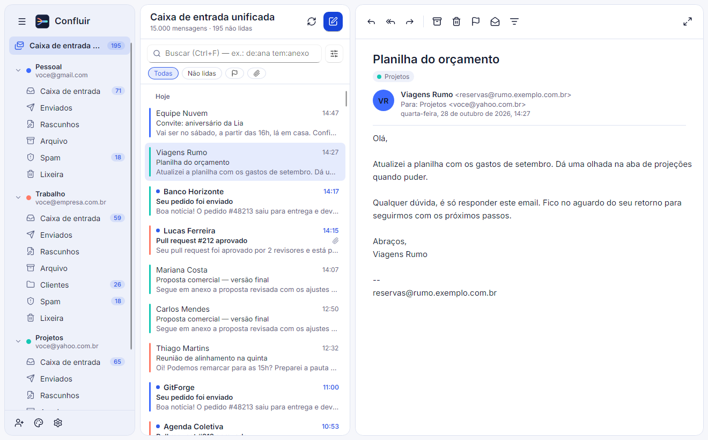
</p>

> As imagens usam os **dados de exemplo** do app (`--dados-falsos`): nenhuma conta ou mensagem real.

## Recursos

- **Várias contas, uma caixa de entrada** — Gmail, Yahoo, Outlook/Hotmail (login da Microsoft, OAuth2) e qualquer servidor IMAP/SMTP, cada conta com sua cor. Os servidores são detectados pelo endereço de email.
- **Rápido e offline** — tudo é lido de um cache local (SQLite): abre na hora, funciona sem conexão e sincroniza em segundo plano (IMAP IDLE, CONDSTORE). Ações feitas offline vão para uma fila e são enviadas quando a rede volta.
- **HTML seguro** — emails sanitizados num WebView nativo, sem scripts, com imagens remotas (rastreadores) bloqueadas até você permitir.
- **Escrever** — responder, responder a todos e encaminhar, editor com formatação (ou texto simples), anexos por arrastar e soltar, sugestão de destinatários, rascunhos salvos sozinhos (no computador e no servidor) e envio em segundo plano.
- **Busca** — texto completo (assunto, remetente, destinatários e corpo), sem acentos e por prefixo, com operadores (`de:`, `para:`, `assunto:`, `tem:anexo`, `não:lida`), filtro avançado e busca no servidor.
- **Filtros e regras** — filtros rápidos (não lidas, sinalizadas, com anexo) e regras que arquivam, movem, excluem, sinalizam ou marcam como lida as mensagens que chegam.
- **Várias de uma vez** — selecione com Shift/Ctrl e arquive, exclua, sinalize ou marque como lidas; menu do botão direito em cada mensagem; aviso com **Desfazer** após cada ação.
- **Teclado** — atalhos para escrever, buscar, responder, arquivar, excluir, sinalizar e sincronizar.
- **Notificações e bandeja** — aviso do sistema para mensagens novas (com não perturbe e escolha por conta), ícone na bandeja com as não lidas, iniciar com o sistema.
- **Do seu jeito** — tema claro, escuro ou do sistema, cor de destaque, modo compacto, duas ou três colunas, tamanho do texto da lista, fontes do sistema, embutidas, de arquivo ou do Google Fonts, e escala da interface.
- **Três idiomas** — Português (Brasil), English e Español, com troca instantânea.

<table>
  <tr>
    <td>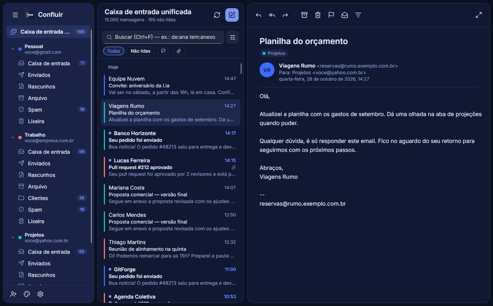</td>
    <td>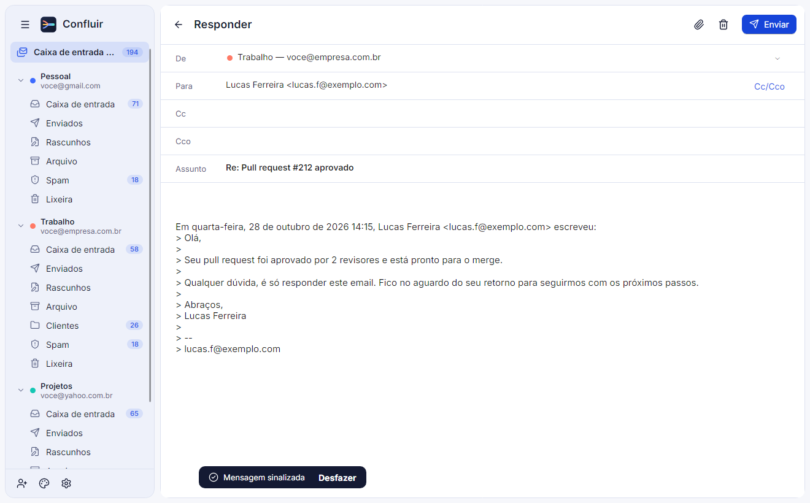</td>
  </tr>
  <tr>
    <td align="center">Tema escuro</td>
    <td align="center">Responder, com citação e sugestões</td>
  </tr>
  <tr>
    <td>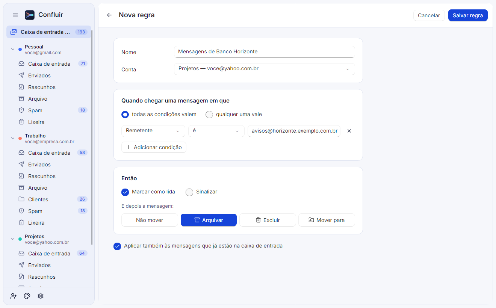</td>
    <td>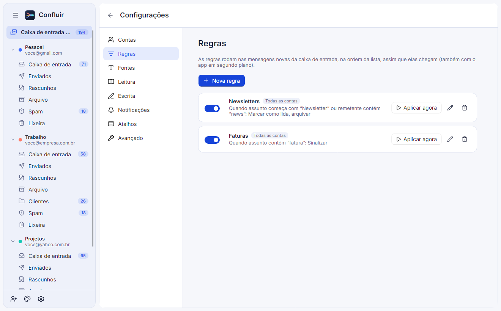</td>
  </tr>
  <tr>
    <td align="center">Regra criada a partir de uma mensagem</td>
    <td align="center">Regras em Configurações</td>
  </tr>
  <tr>
    <td>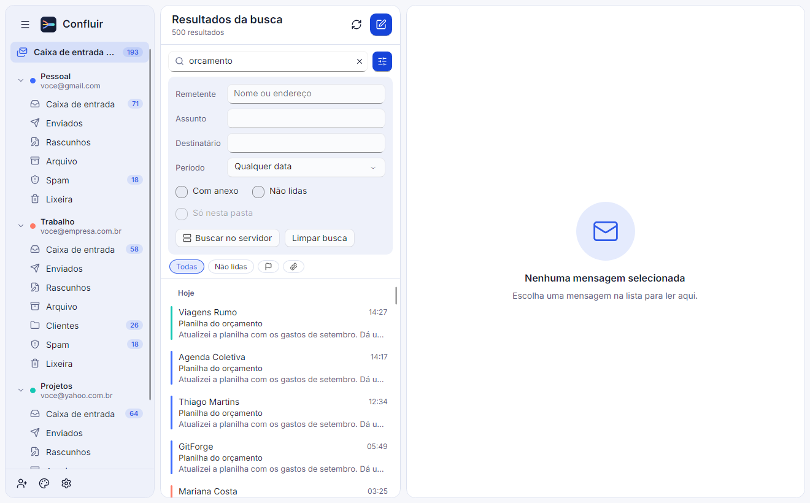</td>
    <td>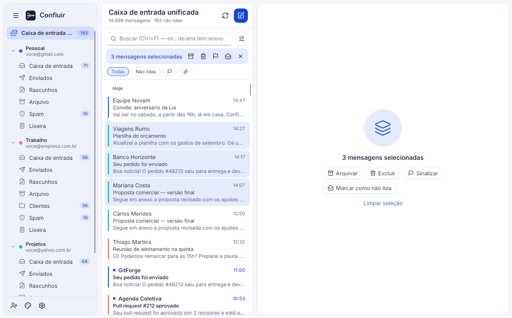</td>
  </tr>
  <tr>
    <td align="center">Busca com filtro avançado</td>
    <td align="center">Ações em várias mensagens</td>
  </tr>
  <tr>
    <td>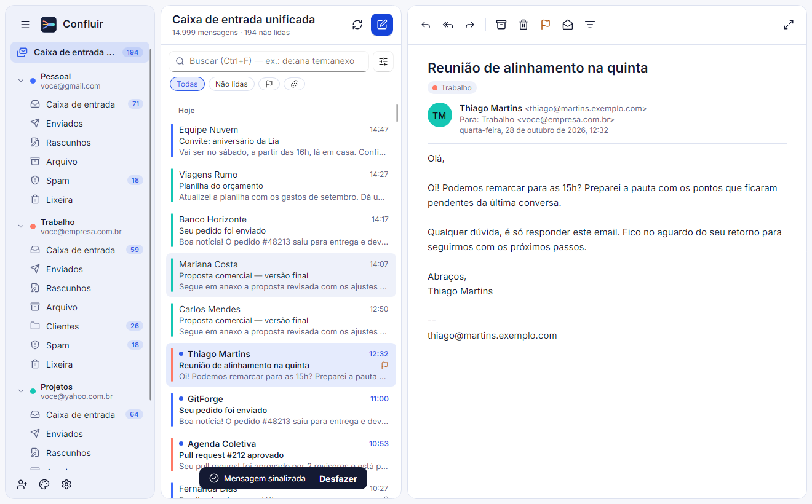</td>
    <td>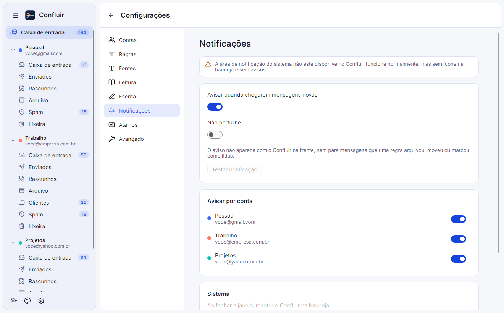</td>
  </tr>
  <tr>
    <td align="center">Aviso após cada ação, com Desfazer</td>
    <td align="center">Notificações, bandeja e início com o sistema</td>
  </tr>
  <tr>
    <td>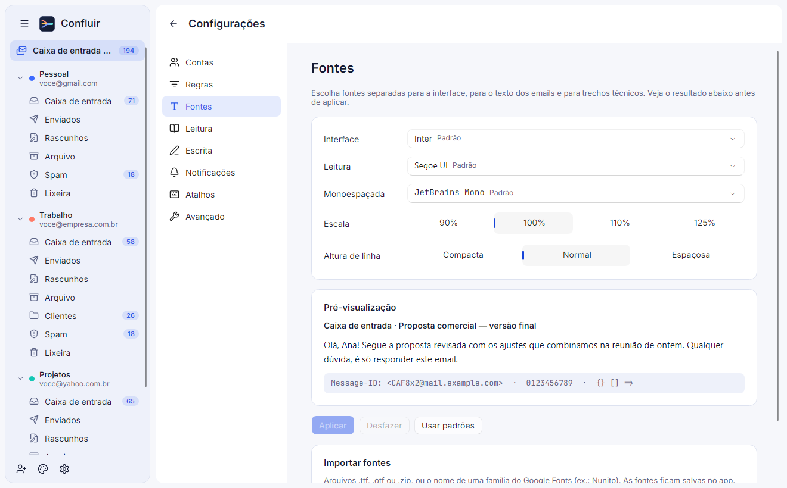</td>
    <td>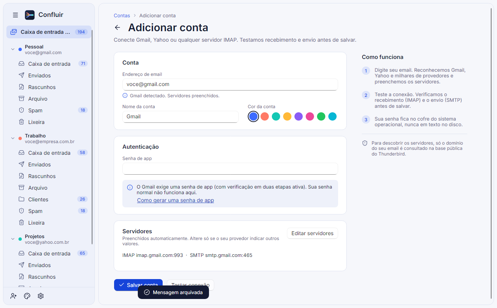</td>
  </tr>
  <tr>
    <td align="center">Fontes com pré-visualização</td>
    <td align="center">Adicionar conta (servidores detectados)</td>
  </tr>
</table>

## Instalar

Baixe na [página de lançamentos](https://github.com/igoreusttaquio/Confluir/releases/latest):

| Sistema | Arquivo | Observação |
|---|---|---|
| Windows 10/11 (x64) | `Confluir-Setup-x64.exe` | Instala para o seu usuário, sem pedir administrador. Usa o WebView2, que já vem no Windows 10/11. |
| Ubuntu, Debian e derivados (x64) | `confluir_amd64.deb` | `sudo apt install ./confluir_amd64.deb` |
| macOS (Apple Silicon) | `Confluir-macOS-arm64.dmg` | Ainda sem assinatura da Apple: na primeira vez, botão direito no app → **Abrir**. |
| macOS (Intel) | `Confluir-macOS-x64.dmg` | Idem. |

Os dados do app (contas, cache, configurações, fontes importadas, logs) ficam em `%APPDATA%\Confluir` no Windows, `~/.config/Confluir` no Linux e `~/Library/Application Support/Confluir` no macOS, e não são apagados ao desinstalar. Senhas e tokens ficam no cofre do sistema (DPAPI, Keychain ou libsecret).

## Configurar contas

Use **Adicionar conta** (rodapé da barra lateral, ou Configurações → Contas). Gmail e Yahoo pedem uma senha de app; Outlook/Hotmail usa o login da Microsoft.

<details>
<summary><b>Senha de app — Gmail</b></summary>

1. Ative a verificação em duas etapas em <https://myaccount.google.com/security>.
2. Acesse <https://myaccount.google.com/apppasswords>, dê um nome (ex.: "Confluir") e gere a senha.
3. Use a senha de 16 caracteres no lugar da sua senha normal.
</details>

<details>
<summary><b>Senha de app — Yahoo</b></summary>

1. Em <https://login.yahoo.com/account/security>, abra **Gerar senha de app** (ou "Gerenciar senhas de app").
2. Dê um nome ao app, gere e use a senha exibida.
</details>

<details>
<summary><b>Outlook/Hotmail</b></summary>

Use **Entrar com a Microsoft** ao adicionar a conta: o navegador abre, você entra e autoriza, e o Confluir testa IMAP e SMTP sozinho. Não há senha de app nem nada para configurar. Os tokens ficam no cofre do sistema e são renovados sozinhos; se a sessão expirar, edite a conta e entre de novo.

No Outlook.com, o IMAP precisa estar ativo: Configurações → Email → Encaminhamento e IMAP.
</details>

## Compilar e rodar

Requisitos: SDK do .NET 10 (fixado em `global.json`).

```sh
dotnet build Confluir.sln
dotnet run --project src/Confluir.App                    # app normal
dotnet run --project src/Confluir.App -- --dados-falsos  # contas e mensagens de exemplo, sem servidores
dotnet test --solution Confluir.sln
```

No Linux, o leitor de HTML usa o WebKitGTK (`libwebkit2gtk-4.1-0`) e o cofre de senhas, o libsecret (`libsecret-1-0`).

### Ferramentas

| Projeto | Para quê |
|---|---|
| `tools/Confluir.Snapshot` | Renderiza as telas sem abrir janela (Avalonia Headless + Skia), com dados de exemplo numa pasta temporária, e salva PNGs. As capturas deste README e do site saem daqui. `dotnet run --project tools/Confluir.Snapshot -- <pasta>` |
| `tools/Confluir.IconGen` | Gera `assets/icone/confluir.icns` e `assets/icone/png/*.png` a partir do SVG. `dotnet run --project tools/Confluir.IconGen -- assets/confluir-icone.svg assets/icone` |

### Login da Microsoft (uma vez, para quem publica o app)

O Outlook/Hotmail exige OAuth2, e o Confluir precisa de um app registrado no Entra ID. O ID desse app **não é segredo** (apps desktop são "clientes públicos", como o Thunderbird) e vai **embutido nos instaladores** — quem usa o Confluir só clica em "Entrar com a Microsoft". Sem ele, a opção aparece como indisponível e o resto funciona.

1. Em <https://entra.microsoft.com> → **Aplicativos** → **Registros de aplicativo** → **Novo registro**.
2. Tipos de conta: **Contas em qualquer diretório organizacional e contas pessoais da Microsoft**.
3. URI de redirecionamento: plataforma **Aplicativos móveis e da área de trabalho**, valor `http://localhost`.
4. Em **Autenticação**, habilite **Permitir fluxos de cliente público**.
5. Em **Permissões de API** → **Adicionar** → **APIs que minha organização usa** → *Office 365 Exchange Online* → permissões delegadas `IMAP.AccessAsUser.All` e `SMTP.Send`.
6. Copie o **ID do aplicativo (cliente)** e cadastre no GitHub em **Settings → Secrets and variables → Actions → Variables** com o nome `MICROSOFT_CLIENT_ID`. O workflow de instaladores passa a embuti-lo.

Para compilar localmente com o login, defina a variável de ambiente `CONFLUIR_MICROSOFT_CLIENT_ID` antes do `dotnet build` (ou use `-p:ConfluirMicrosoftClientId=<id>`).

### Instaladores e site

| Arquivo | O que faz |
|---|---|
| `.github/workflows/release.yml` | Ao enviar uma tag `v*` (ex.: `git tag v0.1.0 && git push origin v0.1.0`): roda os testes, gera o instalador do Windows (Inno Setup, `packaging/windows/confluir.iss`), o `.deb` (`packaging/linux/build-deb.sh`) e os `.dmg` do macOS para Apple Silicon e Intel (`packaging/macos/build-dmg.sh`), e publica um lançamento com eles e as somas SHA-256. Também pode ser rodado à mão em **Actions → Instaladores**, gerando só os artefatos. |
| `docs/` | Site (landing page) publicado pelo GitHub Pages a partir da pasta `/docs` do branch `main` (**Settings → Pages → Deploy from a branch → main / docs**). |

Os instaladores são *self-contained* (não precisam do .NET instalado) e compilados com ReadyToRun (inicialização mais rápida). Os `.dmg` têm só assinatura ad hoc: para abrir sem o aviso do Gatekeeper seria preciso um certificado Developer ID e notarização da Apple.

## Estrutura

```
src/Confluir.App    Avalonia: Views, ViewModels, temas, estilos, recursos, fontes embutidas
src/Confluir.Core   Modelos, interfaces, regras de negócio (sem UI nem MailKit)
src/Confluir.Mail   IMAP/SMTP, sincronização, sanitização de HTML
src/Confluir.Auth   OAuth2 (MSAL) e cofre de credenciais
src/Confluir.Data   SQLite: cache, fila de operações, rascunhos
tests/              xUnit v3 (Core, Mail, Data, App)
tools/              Snapshot e IconGen
packaging/          Inno Setup, .deb e .app/.dmg
docs/               Site do GitHub Pages (index.html, imagens, capturas) e documentos
```

## Decisões técnicas

| Tema | Escolha | Motivo |
|---|---|---|
| UI | Avalonia 12.1.4 | Multiplataforma, última estável no NuGet. |
| Camada visual | **FluentAvaloniaUI 3.1** (`FluentAvaloniaTheme`) | Compilado para Avalonia 12.1, mantido, visual WinUI coerente e geração da rampa de destaque a partir de uma cor. |
| Ícones | **Lucide.Avalonia** | Primeira opção do plano; testado no Avalonia 12. Plano B: FluentIcons.Avalonia. |
| Cores | Tokens em `Themes/Light.axaml` e `Themes/Dark.axaml` via `ThemeDictionaries`, sempre com `DynamicResource` | A cor de destaque do usuário é gravada no dicionário raiz (`Accent`, `OnAccent` por contraste WCAG, `AccentSubtle`). |
| Fontes | Inter, Source Serif 4 e JetBrains Mono embutidas (OFL); importadas ficam em `<dados>/fonts/<família>` | Carregadas por coleções de fonte do Avalonia (`EmbeddedFontCollection` e uma coleção de arquivos). Google Fonts pela API de CSS, que entrega TTF quando o cliente não pede WOFF2; a licença vem do repositório `google/fonts`. No leitor, a fonte vai como `@font-face` com `data:` (o documento não acessa a rede). |
| Strings e idiomas | `Resources/Strings.resx` (pt-BR) + `Strings.en.resx` + `Strings.es.resx` | No XAML, `{l:Tr Chave}` (atualiza ao trocar de idioma). Testes garantem as mesmas chaves e marcadores nos três. **Toda string nova vai para os três arquivos.** Detalhes em [docs/PLANO_IDIOMAS.md](docs/PLANO_IDIOMAS.md). |
| Navegação | Telas dentro da janela principal (`NavigationService`, Esc volta), confirmações inline | O app prefere navegar a abrir janelas ou diálogos modais. |
| Email | MailKit/MimeKit 4.18 | Uma conexão IMAP por conta (`ImapConnectionPool`), reconexão automática. SMTP com troca automática de porta (465 ↔ 587) se uma estiver bloqueada. |
| Cofre de credenciais | `Microsoft.Identity.Client.Extensions.Msal` | Windows: DPAPI; macOS: Keychain; Linux: libsecret. Sem cofre, falha em vez de gravar em texto puro. |
| Banco local | SQLite (`Microsoft.Data.Sqlite` + Dapper), WAL, migrações por `PRAGMA user_version` | Toda consulta roda fora da thread da interface (o provedor do SQLite é síncrono por dentro). |
| Sincronização | `SyncingMailboxService` (um laço e um IDLE por conta) + `ImapSyncEngine` + `SyncPlanner` | O planejador compara UIDs do servidor com os do cache e é testado isoladamente. As regras rodam aqui, nas mensagens que acabaram de chegar, e as ações vão pela mesma fila otimista. |
| Autoconfiguração | ISPDB do Thunderbird | Cobre milhares de provedores. Só o **domínio** é enviado, nunca o endereço. |
| WebView | **`Avalonia.Controls.WebView`** (`NativeWebView`, MIT) | Usa o motor do sistema (WebView2, WebKit, WebKitGTK), sem embutir o Chromium. Sem motor, o leitor e a escrita usam texto puro. Sessão sem persistência. |
| Segurança do HTML | `HtmlSanitizer` + CSP | O sanitizador remove scripts, iframes, formulários e handlers; a CSP (`default-src 'none'`) impede execução e acesso à rede mesmo se algo passar. O editor de mensagens só roda o próprio script (nonce). |
| Editor de mensagens | `contenteditable` no WebView | O editor rico do Avalonia é pago (Pro). O editor avisa que o texto mudou e o app pede o HTML só ao salvar, enviar ou sair, para digitar sem atrasos. |
| Testes | xUnit v3 no Microsoft Testing Platform | Exigido pelo `dotnet test` do .NET 10 (`global.json` → `test.runner`). |

Limitações conhecidas: remoções no servidor são detectadas com `UID SEARCH ALL` (QRESYNC ainda não é usado); a condição "destinatário" das regras vale para mensagens sincronizadas a partir da versão com regras; os instaladores do macOS e do Linux ainda não foram testados em máquinas reais.
